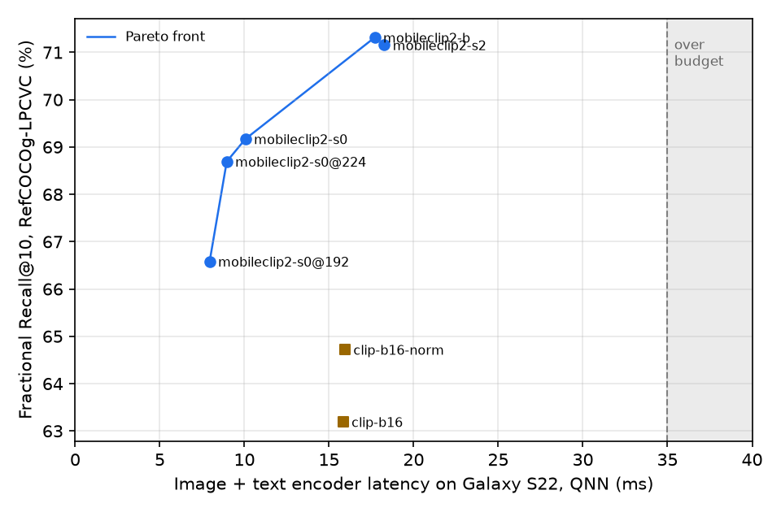

# 004 · S22 latency and on-device accuracy of all candidate models

## Question
Which candidate models fit the 35 ms S22 budget, what does each cost in latency, and does lowering S0's resolution actually save time on the NPU?

## Setup and results
<!-- AUTO:BEGIN (regenerated by lpcvc/experiment.py, edit outside this block) -->
**Status:** ok  
**Run:** 2026-11-17T15:14:20+00:00 → 2026-11-17T16:29:36+00:00 (UTC)  
**Code:** commit `a65b5849c3`  
**Hardware/software:** NVIDIA GeForce RTX 4080 SUPER, Windows-10-10.0.26300-SP0, torch 2.14.1+cu126, open_clip 4.2.2, qai_hub 0.58.0

**Reproduce:**
```bash
.venv/python scripts/aihub_run.py --exp s22-profile-candidates --title 'S22 latency and on-device accuracy of all candidate models' --question 'Which candidate models fit the 35 ms S22 budget, what does each cost in latency, and does lowering S0'"'"'s resolution actually save time on the NPU?' --models clip-b16 clip-b16-norm mobileclip2-s0 mobileclip2-s0@224 mobileclip2-s0@192 mobileclip2-s2 mobileclip2-b --profile-runs 3
```

| Model | Image ms | Text ms | **Total ms** | <35 ms | Peak mem MiB (img/txt) | ONNX MiB (img/txt) | Device frac R@10, sample | RefCOCOg-LPCVC frac R@10 (local) | Fidelity cos min (img/txt) |
|---|---|---|---|---|---|---|---|---|---|
| clip-b16 | 12.71 (12.71-12.76) | 3.11 (3.11-3.13) | **15.83** | yes | 204/134 | 329/242 | 87.35 | 63.19 | 0.9999/1.0000 |
| clip-b16-norm | 12.82 (12.75-12.88) | 3.11 (3.11-3.13) | **15.94** | yes | 207/134 | 329/242 | 88.85 | 64.72 | 1.0000/1.0000 |
| mobileclip2-s0 | 6.84 (6.83-6.87) | 3.22 (3.22-3.24) | **10.06** | yes | 128/184 | 43/242 | 89.30 | 69.17 | 0.9998/1.0000 |
| mobileclip2-s0@224 | 5.73 (5.71-5.75) | 3.22 (3.22-3.24) | **8.96** | yes | 122/184 | 43/242 | 88.82 | 68.69 | 0.9998/1.0000 |
| mobileclip2-s0@192 | 4.72 (4.71-4.73) | 3.22 (3.22-3.24) | **7.94** | yes | 124/184 | 43/242 | 89.00 | 66.58 | 0.9998/1.0000 |
| mobileclip2-s2 | 15.02 (15.01-15.03) | 3.24 (3.21-3.25) | **18.26** | yes | 223/162 | 136/242 | 89.45 | 71.15 | 0.9998/1.0000 |
| mobileclip2-b | 14.43 (14.43-14.45) | 3.27 (3.26-3.27) | **17.70** | yes | 163/162 | 330/242 | 88.85 | 71.31 | 1.0000/1.0000 |

Latency: median of 3 AI Hub profile runs (min-max in parentheses), 100 iterations each. Job IDs and links are in `results.json`.

**Headline:** best valid by RefCOCOg: mobileclip2-b (17.7 ms)

Files: `manifest.json` (exact environment and args), `log.txt` (full console output), result JSON/NPZ files.
<!-- AUTO:END -->

## Conclusions


(`.venv/python scripts/plot_pareto.py experiments/004_s22-profile-candidates`)

- **All seven models fit the 35 ms budget.** Profiles are very stable (3 runs, spread ≤ 0.13 ms), every layer of every
  model runs on the NPU, and device embeddings match local PyTorch (cosine ≥ 0.9998). So the local RefCOCOg-LPCVC
  accuracies in the table hold for the deployed models.
- **QNN is much faster than TFLite for the baseline:** CLIP ViT-B/16 takes 15.83 ms here vs. 22.25 ms in the
  teammate's TFLite run (S0: 10.06 vs 9.70). We report QNN, the runtime of the official sample and the submission.
- **Pareto front:** S0@192 (7.9 ms, 66.6) → S0@224 (9.0, 68.7) → S0 (10.1, 69.2) → **B (17.7 ms, 71.3)**. CLIP (both
  variants) is dominated by every MobileCLIP2 model. B dominates S2: it is faster (17.7 vs 18.3) and as accurate
  (71.3 vs 71.2, within CI).
- **The text encoder is a fixed about 3.2 ms** for every model (all are 12-layer, 512-wide transformers). The image
  tower decides the ranking. B's image tower is slower than CLIP's (14.4 vs 12.7 ms) even though both are ViT-B/16
  sized, which is plausibly MobileCLIP2-B's convolutional stem. Not investigated.
- **Resolution reduction works but isn't worth it here.** S0 at 224/192 saves 1.1/2.1 ms (only the image tower
  shrinks) for −0.5/−2.6 points, and we are nowhere near the budget.
- The official baseline's input-normalization fix costs 0.11 ms for +1.5 points.
- **Decision:** the competition ranks valid submissions by accuracy alone, and the best valid model so far is
  **MobileCLIP2-B at 17.7 ms with +8.1 points over the official baseline**, which leaves about 17 ms of headroom.
  Next: (a) check whether larger models (S3, S4, B at a higher resolution) fit the headroom; (b) INT8 quantization of B,
  which would make room for a bigger model or a better efficiency story; (c) distill or fine-tune on LPCVC-style
  data. For the efficiency narrative of the report, S0 (10.1 ms, 69.2) is our "speed" operating point.
