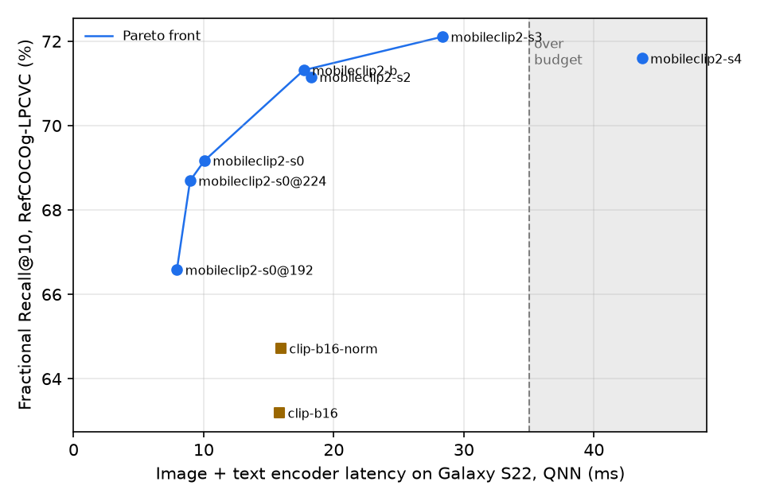

# 006 · S22 latency of the larger MobileCLIP2 models (S3, S4)

## Question
Do MobileCLIP2-S3 and S4 fit the 35 ms S22 budget?

## Setup and results
<!-- AUTO:BEGIN (regenerated by lpcvc/experiment.py, edit outside this block) -->
**Status:** ok  
**Run:** 2026-11-17T16:49:41+00:00 → 2026-11-17T17:50:51+00:00 (UTC)  
**Code:** commit `4ff115d98b` (+ uncommitted changes in lpcvc/ or scripts/)  
**Hardware/software:** NVIDIA GeForce RTX 4080 SUPER, Windows-10-10.0.26300-SP0, torch 2.14.1+cu126, open_clip 4.2.2, qai_hub 0.58.0

**Reproduce:**
```bash
.venv/python scripts/aihub_run.py --exp s22-profile-large --title 'S22 latency of the larger MobileCLIP2 models (S3, S4)' --question 'Do MobileCLIP2-S3 and S4 fit the 35 ms S22 budget?' --models mobileclip2-s3 mobileclip2-s4 --profile-runs 3
```

| Model | Image ms | Text ms | **Total ms** | <35 ms | Peak mem MiB (img/txt) | ONNX MiB (img/txt) | Device frac R@10, sample | RefCOCOg-LPCVC frac R@10 (local) | Fidelity cos min (img/txt) |
|---|---|---|---|---|---|---|---|---|---|
| mobileclip2-s3 | 23.07 (22.97-23.14) | 5.29 (5.29-5.30) | **28.36** | yes | 354/97 | 477/472 | 89.36 | 72.11 | 0.9998/1.0000 |
| mobileclip2-s4 | 38.42 (38.32-38.67) | 5.28 (5.27-5.31) | **43.70** | NO | 262/161 | 1227/472 | 88.76 | 71.59 | 0.9999/1.0000 |

Latency: median of 3 AI Hub profile runs (min-max in parentheses), 100 iterations each. Job IDs and links are in `results.json`.

**Headline:** best valid by RefCOCOg: mobileclip2-s3 (28.4 ms)

Files: `manifest.json` (exact environment and args), `log.txt` (full console output), result JSON/NPZ files.
<!-- AUTO:END -->

## Conclusions


(`.venv/python scripts/plot_pareto.py experiments/004_s22-profile-candidates experiments/006_s22-profile-large`)

- **S3 fits:** 23.07 ms image + 5.29 ms text = **28.36 ms**, valid. **S4 does not:** 38.42 + 5.28 = **43.70 ms**,
  8.7 ms over budget. All layers are on the NPU and device/local cosine is ≥ 0.9998, as before.
- The 768-wide text encoder of S3/S4 costs 5.3 ms vs 3.2 ms for B/S0. That's +2 ms, independent of the image tower.
- **S3 is the most accurate valid model** (72.11 on RefCOCOg-LPCVC), but only **+0.79 points over B** (paired
  CI +0.06…+1.50, see 005) for **+10.7 ms (+60%)**. S4 is dominated (slower and less accurate than S3).
- Pareto front: S0@192 → S0@224 → S0 → B → S3.
- **Decision:** B stays our main model (best accuracy per ms, and room for quantization and fine-tuning to add
  accuracy). S3 is the "max accuracy under budget" fallback for the leaderboard: if quantization makes S3's image
  tower much faster, it becomes attractive, so quantize S3 too if 008 shows a large INT8 speedup.
